# Siphamandla Mjoli

Hi 👋 I'm Spha. I build protocol software and zero-knowledge systems in Rust, Solidity and TypeScript. I'm also an applied cryptography researcher focused on the efficiency of PLONKish systems in resource-constrained environments.

## Contact

Email me at [sphamjoli@gmail.com](mailto:sphamjoli@gmail.com).
